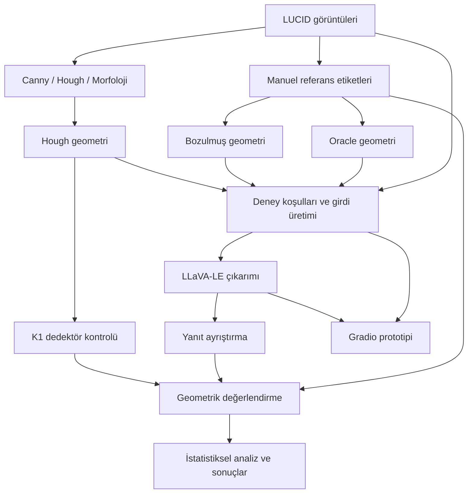

# Lunar Crater VLM

**Ay Yüzeyindeki Kraterlerin Görüntü-Dil Modelleriyle Analizi: Geometrik Kanıtla Desteklenen Görsel Muhakeme**

TÜBİTAK 2209-A | Bilgisayar Mühendisliği | 3 öğrenci ve akademik danışman

**Proje durumu:** Planlama ve teknik fizibilite. Bu README hedef mimariyi tanımlar; yazılım modülleri ve deney sonuçları henüz oluşturulmuş veya doğrulanmış kabul edilmemelidir.

## 1. Proje hakkında

Bu araştırma, Ay yüzeyi görüntülerindeki kraterlerin sayımı, konumlandırılması, boyutlandırılması ve morfolojik açıklanmasında görüntü-dil modellerinin (Vision-Language Models, VLM) performansını incelemektedir. Temel araştırma sorusu, klasik görüntü işleme yöntemleriyle elde edilen geometrik kanıtların LLaVA-LE modelinin yanıt doğruluğunu artırıp artırmadığıdır.

LLaVA-v1.5-13B tabanlı LLaVA-LE'nin yayımlanmış ağırlıkları kullanılacaktır. Birincil kapsam yeni model mimarisi geliştirmek veya sıfırdan model eğitmek değildir. Makale yazımı bu deponun başlangıç teknik kapsamına dahil değildir.

### Araştırma hipotezleri

- **H1:** Geometrik kanıt sayım MAE değerini azaltır ve konum F1 değerini artırır.
- **H2:** Geometrik kanıt referans etiketlerle eşleşmeyen krater bildirme oranını azaltır.
- **H3:** Geometri kalitesi düştükçe performans kazancı azalır.

Bu hipotezler deneylerle sınanacaktır; olumlu sonuç elde edilmesi bir tamamlanma şartı değildir.

## 2. Sistem mimarisi



Görüntü işleme hattı krater adaylarının merkezini, yarıçapını, kenar güvenini ve komşuluk bilgilerini üretir. Geometrik kanıt modele işaretli görüntü, yapılandırılmış metin veya çok ölçekli kırpım mozaiği olarak sunulur. Model yanıtları referans etiketlerle karşılaştırılır.

## 3. Veri ve deney tasarımı

- Veri kaynağı: LUCID veri seti; krater yoğunluğu ve aydınlatmaya göre katmanlı seçim.
- Pilot: 10 görüntü; parametre ve prompt ayarlaması için nihai testten ayrı tutulur.
- Nihai değerlendirme: 150 görüntü; proje yürütücüsü tarafından merkez ve yarıçap etiketlemesi.
- Tutarlılık: en az 30 görüntünün aynı etiketleyici tarafından kör tekrar etiketlenmesi; IoU ≥ 0,5 ile en az %80 eşleşme hedefi.
- Uygun coğrafi metadata varsa Robbins kataloğuyla yardımcı çapraz kontrol.
- Eğitim/test örtüşmesi mümkün olduğu ölçüde denetlenir; doğrulanamayan örnekler işaretlenir.

| Koşul | Girdi | Geometri | Yanıt hedefi |
|---|---|---|---:|
| B0 | Ham görüntü | Yok | 600 |
| B1 | İşaretli görüntü | Oracle, Hough, bozulmuş | 1800 |
| B2 | Ham görüntü + metinsel geometri | Oracle, Hough, bozulmuş | 1800 |
| B3 | Ham görüntü + işaretli kırpımlar + metin | Oracle, Hough, bozulmuş | 1800 |
| B3-T | İşaretli tam görüntü + metin | Hough | 600 |
| K1 | Yalnızca dedektör; VLM yok | Hough | 0 |
| K2 | Yalnızca metinsel geometri | Oracle, Hough, bozulmuş | 1800 |
| **Toplam** | **14 VLM çalıştırması** | | **8400** |

Her VLM çalıştırması aynı 150 görüntüye dört soru türü (sayım, konum, boyut, morfoloji) uygular. K1 geometrik çıktıları doğrudan hesaplar. Yeniden sorgulamalar ek model çağrısı oluşturabilir. K2 görüntüsüz çalışmazsa sabit nötr görüntü kullanımı pilotta doğrulanır ve sınırlılık kaydedilir.

## 4. Hedef proje dizini

Aşağıdaki dosyalar ve klasörler oluşturulacaktır. `PROJECT_PLAN.md` ayrıntılı iş bölümü ve görev takibinin ana kaynağıdır.

```text
lunar-crater-vlm/
├── PROJECT_PLAN.md
├── README.md
├── requirements.txt
├── .gitignore
├── configs/
│   ├── model.yaml
│   ├── detector.yaml
│   └── experiments.yaml
├── data/
│   ├── raw/
│   ├── pilot/
│   ├── images/
│   ├── annotations/
│   └── metadata/
├── src/
│   ├── dataset/
│   │   ├── loader.py
│   │   ├── sampling.py
│   │   └── annotation_utils.py
│   ├── vision/
│   │   ├── preprocessing.py
│   │   ├── crater_detector.py
│   │   ├── geometry_generator.py
│   │   ├── geometry_corruption.py
│   │   ├── visual_marker.py
│   │   └── multiscale_crop.py
│   ├── vlm/
│   │   ├── model_loader.py
│   │   ├── inference.py
│   │   ├── prompts.py
│   │   └── response_parser.py
│   └── evaluation/
│       ├── circle_iou.py
│       ├── matching.py
│       ├── metrics.py
│       └── statistical_analysis.py
├── experiments/
│   ├── experiment_runner.py
│   ├── conditions.py
│   └── checkpoint.py
├── results/
│   ├── predictions/
│   ├── geometry/
│   ├── metrics/
│   ├── figures/
│   └── logs/
├── tests/
├── docs/
│   ├── ANNOTATION_GUIDE.md
│   ├── EXPERIMENT_PROTOCOL.md
│   └── PROGRESS.md
└── app.py
```

### Dosya ve modül sorumlulukları

| Yol | İşlev | Sorumlu |
|---|---|---|
| `README.md` | Proje tanıtımı, mimari ve kullanım rehberi | Ortak |
| `PROJECT_PLAN.md` | Görev kodları, takvim ve tamamlanma ölçütleri | Ortak |
| `requirements.txt` | Pilotla doğrulanan Python bağımlılıkları | Ortak |
| `.gitignore` | Veri, ağırlık, ortam ve gizli bilgilerin Git dışında tutulması | Ortak |
| `configs/model.yaml` | Model yolu, nicemleme, cihaz ve üretim ayarları | Ö3 |
| `configs/detector.yaml` | Canny, Hough, morfoloji ve aday eleme ayarları | Ö2 |
| `configs/experiments.yaml` | Koşullar, kaynaklar, manifest ve deney ayarları | Ö3 / ortak |
| `src/dataset/loader.py` | Görüntü ve metadata yükleme | Ö1 |
| `src/dataset/sampling.py` | Katmanlı örnekleme, pilot/test ayrımı | Ö1 |
| `src/dataset/annotation_utils.py` | Etiket dönüşümü ve şema doğrulama | Ö1 |
| `src/vision/preprocessing.py` | Gri tonlama, kontrast, filtreleme ve morfoloji | Ö2 |
| `src/vision/crater_detector.py` | Canny/Hough aday tespiti ve tekrar eleme | Ö2 |
| `src/vision/geometry_generator.py` | Aday geometrisi ve yapılandırılmış metin | Ö2 |
| `src/vision/geometry_corruption.py` | Kontrollü geometri bozulması | Ö2 |
| `src/vision/visual_marker.py` | Adayların görüntü üzerinde işaretlenmesi | Ö2 |
| `src/vision/multiscale_crop.py` | Kırpım, mozaik ve koordinat dönüşümleri | Ö2 |
| `src/vlm/model_loader.py` | Model yükleme, nicemleme ve cihaz yönetimi | Ö3 |
| `src/vlm/inference.py` | Model çıkarımı ve kaynak ölçümü | Ö3 |
| `src/vlm/prompts.py` | Dört sabit soru şablonu | Ö3 |
| `src/vlm/response_parser.py` | JSON, regex yedeği ve şema kontrolü | Ö3 |
| `src/evaluation/circle_iou.py` | Analitik daire IoU | Ö1 |
| `src/evaluation/matching.py` | Bire bir ve yumuşak eşleştirme | Ö1 |
| `src/evaluation/metrics.py` | Geometrik performans metrikleri | Ö1 |
| `src/evaluation/statistical_analysis.py` | Eşleştirilmiş testler ve güven aralıkları | Ö1 |
| `experiments/conditions.py` | B0–B3, B3-T, K1, K2 girdi yönlendirmesi | Ö3 / Ö2 |
| `experiments/experiment_runner.py` | Toplu deney otomasyonu | Ö3 |
| `experiments/checkpoint.py` | Kesintiden devam ve benzersiz kayıt yönetimi | Ö3 |
| `tests/` | Birim ve entegrasyon testleri | Ortak |
| `docs/ANNOTATION_GUIDE.md` | Etiketleme protokolü | Ö1 / yürütücü |
| `docs/EXPERIMENT_PROTOCOL.md` | Sabit deney protokolü ve yöntem kararları | Ortak |
| `docs/PROGRESS.md` | İlerleme, sorunlar ve kilometre taşları | Ortak |
| `app.py` | Gradio kullanıcı arayüzü | Ö3 |

### Veri ve sonuç klasörleri

| Klasör | İçerik |
|---|---|
| `data/raw/` | Kaynak görüntü ve metadata |
| `data/pilot/` | Ayrı pilot/geliştirme örnekleri |
| `data/images/` | Nihai değerlendirme görüntüleri |
| `data/annotations/` | Referans etiketler, kör tekrarlar, oracle geometri |
| `data/metadata/` | Manifest, veri ayrımları, lisans ve kaynak bilgileri |
| `results/predictions/` | Ham ve ayrıştırılmış model yanıtları |
| `results/geometry/` | Hough, oracle ve bozulmuş geometri; işaretli çıktılar |
| `results/metrics/` | Metrik ve istatistik tabloları |
| `results/figures/` | Grafik ve hata analizi görselleri |
| `results/logs/` | Deney ayarları, süre, bellek ve hata kayıtları |

Boş dizinler Git tarafından izlenmez; gerekli olanlarda `.gitkeep` kullanılabilir. Bu ek dosyalar isteğe bağlıdır.

## 5. Teknolojiler ve kurulum

Python, PyTorch, Transformers, bitsandbytes, OpenCV, NumPy, SciPy, Pandas, Pillow, Gradio; etiketleme için CVAT veya LabelMe. CUDA destekli NVIDIA GPU birincil çıkarım ortamıdır.

Hedef donanım RTX 4070 Laptop GPU (8 GB VRAM) ve 48 GB RAM'dir. 13B model için 4 bit nicemleme ve CPU offload pilotta denenir. Bellek ve süre uygun değilse T4 sınıfı GPU ortamları değerlendirilir. Modelin çalışabilirliği garanti değildir.

Depo ve bağımlılık dosyası oluşturulduktan sonra başlangıç ortamı:

```bash
python -m venv .venv
```

Windows PowerShell:

```powershell
.\.venv\Scripts\Activate.ps1
```

Linux/macOS:

```bash
source .venv/bin/activate
```

```bash
python -m pip install --upgrade pip
python -m pip install -r requirements.txt
```

`requirements.txt` henüz oluşturulmadıysa son komut çalışmaz. PyTorch/CUDA ve LLaVA-LE bağımlılıklarının uyumlu sürümleri pilot aşamasında doğrulanıp sabitlenecektir. Model ağırlığı indirme komutları ve gerçek deney CLI seçenekleri uygulama tamamlandığında bu belgeye eklenecektir.

Planlanan uygulama giriş noktaları (modüller geliştirildikten sonra):

```bash
python -m experiments.experiment_runner
python app.py
```

Bu komutlar şimdilik hedef kullanım biçimidir, çalıştığı test edilmiş komutlar değildir.

## 6. Ortak veri sözleşmesi

Örnek geometri kaydı (temsili):

```json
{
  "image_id": "lunar_0001",
  "width": 1024,
  "height": 1024,
  "geometry_source": "hough",
  "crater_count": 1,
  "craters": [
    {"id": 1, "x": 0.25, "y": 0.42, "r": 0.08, "edge_confidence": null, "nearest_neighbor_distance_px": null}
  ]
}
```

Orijin sol üst köşedir; x sağa, y aşağı artar. `x = x_px / width`, `y = y_px / height`, `r = r_px / width`. Geometrik hesaplar piksel uzayında yapılır. Kaynak değerleri `oracle`, `hough`, `corrupted`; bilinmeyen ek alanlar `null` olur. Boş aday listesi geçerlidir.

Model sayım yanıtı `{"sayi": 1}`, konum yanıtı `{"craters": [{"x": 0.25, "y": 0.42}]}`, boyut yanıtı `{"craters": [{"x": 0.25, "y": 0.42, "r": 0.08}]}` biçiminde planlanır. Morfoloji serbest metindir. Konum yanıtında yarıçap olmaması ile IoU arasındaki tutarsızlık deney öncesinde danışmanla çözülecektir.

Deney kayıt anahtarı: `run_id + image_id + question_type`. Ham yanıt, ayrıştırılmış çıktı, durum, deneme numarası, model/prompt sürümü, konfigürasyon özeti ve süre saklanır. Ayrıştırma sırası JSON, regex, bir kez yeniden sorgulama şeklindedir. Ham yanıtlar üzerine yazılmaz.

## 7. Değerlendirme

Birincil metrikler sayım MAE, precision, recall, F1, eşleşen kraterlerin yarıçap bağıl hatası ve referansla eşleşmeyen tahmin oranıdır. Daire IoU ≥ 0,5 ve Macar algoritması birincil eşleştirme yaklaşımıdır; yumuşak eşleştirme ikincil analizdir. Yarıçap gerektiren metrikler için veri sözleşmesi kesinleştirilmelidir.

Wilcoxon, McNemar, dokuz doğrulayıcı test için Holm düzeltmesi ve görüntü düzeyinde 1000 bootstrap örneklemesiyle %95 güven aralıkları planlanır. Morfolojik açıklamalar üç boyutlu 0–2 rubrikle ikincil olarak değerlendirilir. B2/B3/K2 kopyalama oranları ve K1/K2 kontrolleri, modelin geometriyi yalnızca aktarmasından öte katkı sağlayıp sağlamadığını incelemek içindir.

## 8. Ekip ve Git çalışma düzeni

| Rol | Ana sorumluluk | Dal |
|---|---|---|
| Öğrenci 1 | Veri, metrikler, istatistik | `feature/dataset`, `feature/evaluation` |
| Öğrenci 2 | Görüntü işleme ve geometri | `feature/vision` |
| Öğrenci 3 | VLM, deney otomasyonu ve arayüz | `feature/vlm`, `feature/interface` |
| Ortak | Entegrasyon ve test | `develop`, `main` |

Öğrenci isimleri ve roller ekip tarafından kesinleştirilecektir. Resmî yürütücü, hangi teknik rolü üstlenirse üstlensin tek etiketleyici olarak kalır. Birleştirmeler pull request ve ekip incelemesi ile yapılır. Büyük görüntüler, ağırlıklar, API anahtarları, sanal ortam ve geçici sonuçlar Git'e yüklenmez. Veri ve model lisansları doğrulanmadan yeniden dağıtım yapılmaz.

## 9. İlk geliştirme adımları

- [ ] Ortak GitHub deposu ve hedef klasör yapısını oluştur.
- [ ] LUCID erişimini ve LLaVA-LE ağırlıklarını doğrula.
- [ ] 10 pilot görüntü seç, etiketleme protokolünü hazırla.
- [ ] Canny/Hough ile ilk adayları üret.
- [ ] Modeli yükle, ilk yanıtı al, bellek ve süreyi ölç.
- [ ] Ortak JSON şemasını ve modül arayüzlerini onayla.
- [ ] B0, B1 ve B2 pilot akışlarını uçtan uca çalıştır.
- [ ] Pilot sonuçları ve açık yöntem kararlarını danışmanla değerlendir.

Ayrıntılı görev kodları, 24 haftalık iç hedef ve 12 aylık resmî takvim için [PROJECT_PLAN.md](PROJECT_PLAN.md) dosyasına bakın.

## 10. Beklenen teknik çıktılar

150 görüntülük referans alt kümesi, üç geometri kaynağı, yedi koşulu kapsayan deney hattı, 8400 hedef model yanıtı, değerlendirme ve istatistik betikleri, grafikler, yeniden üretilebilir kurulum ve kullanıcının kendi görüntüsünü B0–B3 koşullarında inceleyebildiği Gradio prototipi.

## 11. Kaynaklar ve lisans

- LLaVA-LE / LUCID: https://arxiv.org/abs/2603.24696
- LLaVA-1.5: https://arxiv.org/abs/2310.03744
- Robbins krater kataloğu: https://doi.org/10.1029/2018JE005592

Bağlantılar araştırma önerisindeki kaynaklardır; bu README hazırlanırken erişim ve lisans koşulları yeniden doğrulanmamıştır. Depo lisansı ekip ve danışman tarafından belirlenecektir; henüz bir açık kaynak lisansı atanmış değildir.
